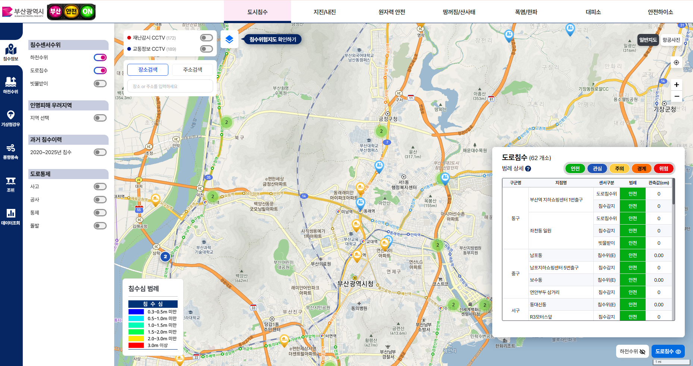
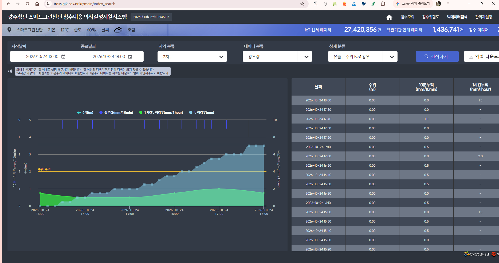
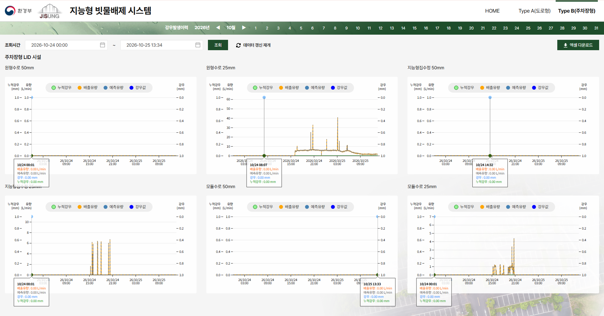
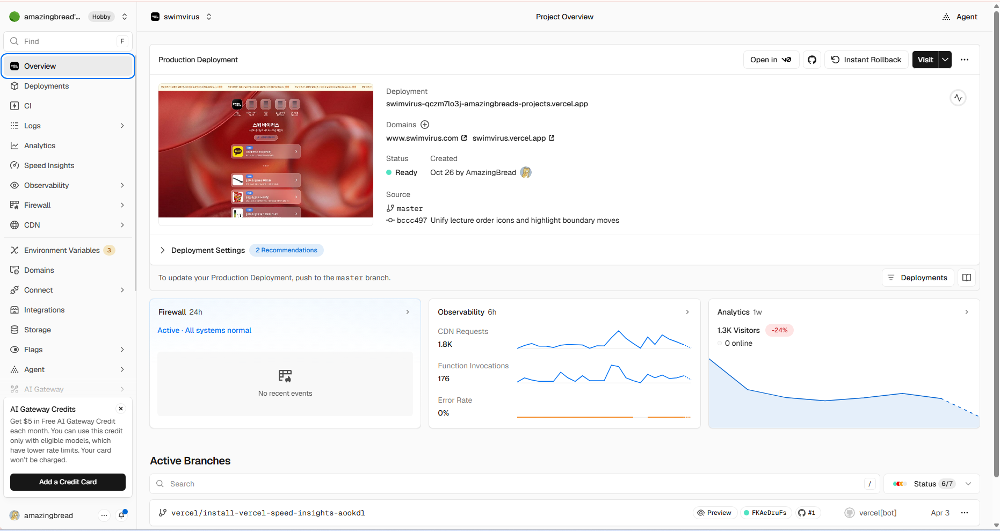

# 프론트엔드 황영균 포트폴리오

**JavaScript 인터랙션 · Vue/Nuxt UI · 공공 관제 화면 개선 · 데이터 시각화**

[포트폴리오 열기 →](https://amazingbread.github.io/city-safety-on/)

## 프로젝트 목차

| 번호 | 프로젝트 | 주요 구현 |
|---|---|---|
| 01 | [부산 도시안전ON](https://amazingbread.github.io/city-safety-on/#city) | HLS 실시간 CCTV · 지도 컴포넌트 · Vuex 테이블/마커 연결 |
| 02 | [아시아드 풍향·풍속 모니터링](https://amazingbread.github.io/city-safety-on/#asiad) | 풍속·돌풍속 시계열 · 극좌표 · 방향 벡터 |
| 03 | [광주첨단 스마트그린산단 침수대응](https://amazingbread.github.io/city-safety-on/#graphs) | 침수위험 이력 지도 재생 · 수위/강우 빅데이터 검색 |
| 04 | [지능형 빗물배제 시스템](https://amazingbread.github.io/city-safety-on/#lid) | 대용량 시계열 구간 탐색 · 1~40배 확대/축소 · 포인터 툴팁 |
| 05 | [스윔바이러스 · 개인 프로젝트](https://amazingbread.github.io/city-safety-on/#swimvirus) | 수영 정보 · 강의 신청 · 데이터 관리 · Git 연동 자동 배포 |

## 구현 기술과 프로젝트

| 구현 주제 | 프로젝트 근거 |
|---|---|
| JavaScript 이벤트·인터랙션 | D3 확대·축소, 포인터 툴팁, HLS 재생 제어 |
| Vue SPA·컴포넌트 | Vuex 테이블·지도 연결, 차트 props 설계 |
| Nuxt·유틸리티 CSS | 스윔바이러스 Nuxt 4 / Tailwind 구성 |
| JSP·jQuery 운영 UI | 광주첨단 검색·Highcharts·이력 재생 |
| Git·운영 배포 | 코드 저장소와 Vercel Git 연동 자동 배포 |

## 01. 부산 도시안전ON

**구현 범위:** HLS 실시간 CCTV · 지도 컴포넌트 · Vuex 테이블/마커 연결

**사용 기술:** Vue 2 · Vuex · Leaflet · hls.js

센서 목록과 지도를 같은 상태로 연결하고 HLS의 재생·정지·자원 해제 흐름을 구현합니다.

[화면 및 상세 설명](https://amazingbread.github.io/city-safety-on/#city) · [구현 코드](projects/city-safety/source/InlineCctvPlayer.vue) · [데이터 또는 추가 근거](projects/city-safety/sync-store.js)

## 02. 아시아드 풍향·풍속 모니터링

**구현 범위:** 풍속·돌풍속 시계열 · 극좌표 · 방향 벡터

**사용 기술:** Vue 2 · D3.js · SVG

API 측정값을 컴포넌트 props로 변환하고 시계열·방향 표현과 최대값 요약을 연결합니다.

[화면 및 상세 설명](https://amazingbread.github.io/city-safety-on/#asiad) · [구현 코드](projects/asiad-wind/source/WindSpeed.vue) · [데이터 또는 추가 근거](projects/asiad-wind/data/measurement-snapshot.json)

실제 측정 스냅샷 1,009건을 사용합니다. 전체·마지막 1일·마지막 3일로 범위를 바꿔 차트와 최대값 요약을 확인할 수 있습니다.

## 03. 광주첨단 스마트그린산단 침수대응

**구현 범위:** 침수위험 이력 지도 재생 · 수위/강우 빅데이터 검색

**사용 기술:** JSP · jQuery · Leaflet · Highcharts

시간별 이력을 병합하고 지도 레이어를 재생합니다. 수위·강우·누적강우를 단위별 다중 축 차트로 구성합니다.

[화면 및 상세 설명](https://amazingbread.github.io/city-safety-on/#graphs) · [구현 코드](projects/gwangju/source/createHighChart.js) · [데이터 또는 추가 근거](projects/gwangju/simulation.txt)

공개 페이지는 실제 운영 화면과 원본 코드 기반 사례 소개입니다. 운영 검색과 지도 재생을 실행하는 데모는 아닙니다.

## 04. 지능형 빗물배제 시스템

**구현 범위:** 대용량 시계열 구간 탐색 · 1~40배 확대/축소 · 포인터 툴팁

**사용 기술:** Vue 2 · D3.js · SVG

zoom 변환으로 시간축과 유량·강우 시리즈를 함께 갱신하고 눈금 밀도를 조절합니다. 실제 4,999건을 실행 화면에 연결했습니다.

[화면 및 상세 설명](https://amazingbread.github.io/city-safety-on/#lid) · [구현 코드](projects/lid/source/ZoomAIComponents.vue) · [데이터 또는 추가 근거](projects/lid/data/measurement-snapshot.json)

실제 spot3 측정 스냅샷 4,999건으로 휠 확대·축소, 드래그 이동, 초기화를 제공합니다. 해당 응답의 강우 배열은 비어 있어 원본 규칙대로 0을 표시합니다.

## 05. 스윔바이러스 · 개인 프로젝트

**구현 범위:** 수영 정보 · 강의 신청 · 데이터 관리 · Git 연동 자동 배포

**사용 기술:** Nuxt 4 · Vue 3 · Tailwind · Supabase · Vercel

사용자 화면과 서버 API, 강의 신청 데이터 처리를 연결하고 Vercel master 브랜치 자동 배포를 구성했습니다.

[화면 및 상세 설명](https://amazingbread.github.io/city-safety-on/#swimvirus) · [구현 코드](https://github.com/AmazingBread/swimvirus)

[서비스 열기](https://www.swimvirus.com) · GitHub master → Vercel 자동 배포 → Production Ready. 공개한 배포 근거는 Git 연동 자동 배포(CD)입니다.

## 코드와 데이터 안내

- `projects/city-safety`: CCTV·지도 원본 SFC와 Vuex 공개 예시
- `projects/asiad-wind`: 원본 D3 컴포넌트와 측정 JSON
- `projects/gwangju`: Highcharts 원본 구현과 지도 재생 코드 발췌
- `projects/lid`: 원본 D3 zoom 컴포넌트와 실제 측정 JSON
- `projects/swimvirus`: 개인 프로젝트 설명과 운영 구성 근거
- [원본 해시 및 변경 범위](docs/source-provenance.json)

## 개발자용 로컬 실행

포트폴리오는 위 공개 URL에서 바로 볼 수 있습니다. 아래는 소스 코드를 내려받아 실행할 때 사용하는 방법입니다. Node.js 18 이상이 필요합니다.

~~~sh
npm start
npm test
npm run build
~~~

로컬 서버 기본 주소: http://127.0.0.1:4173/

## 담당 범위와 AI 도구 활용

프로젝트별 프론트엔드 구현 범위와 원본 코드를 소개합니다. 원본 운영 프로젝트와 공개 실행 어댑터는 별도 저장소에서 관리합니다. 인증 정보·RTSP 주소는 포함하지 않으며 예시 데이터와 실제 측정 스냅샷을 구분합니다.

Codex를 코드 분리, 공개용 실행 어댑터, 검증 보조와 문서 정리에 활용했습니다. 원본 구현, 공개용 어댑터, 측정 데이터의 출처와 변경 범위를 함께 기록합니다.
