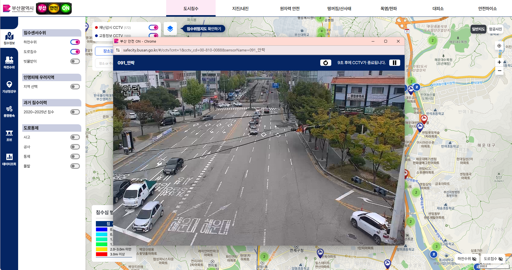
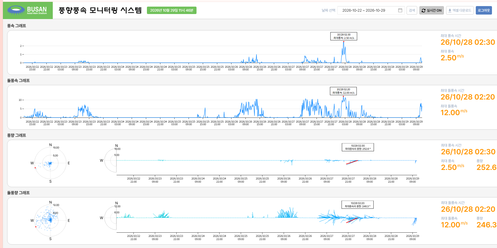
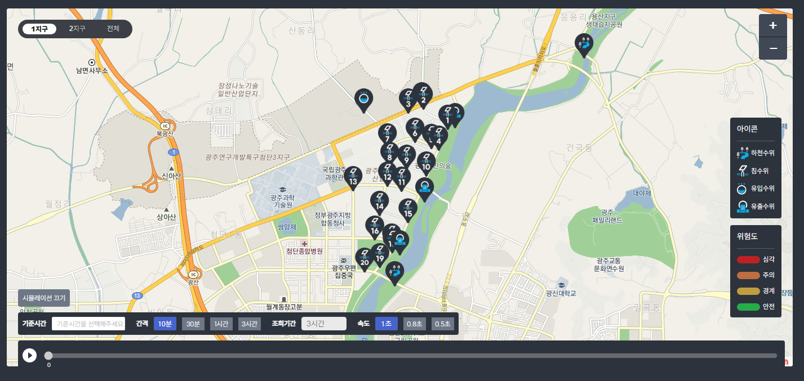

# 프론트엔드 황영균 포트폴리오

**JavaScript 인터랙션 · Vue/Nuxt UI · 공공 관제 화면 개선 · 데이터 시각화**

[포트폴리오 열기 →](https://amazingbread.github.io/city-safety-on/)

## 프로젝트 목차

| 번호 | 프로젝트 | 주요 구현 |
|---|---|---|
| 01 | [부산 도시안전ON](https://amazingbread.github.io/city-safety-on/#city) | HLS 실시간 CCTV · 지도 컴포넌트 · Vuex 테이블/마커 연결 |
| 02 | [아시아드 풍향·풍속 모니터링](https://amazingbread.github.io/city-safety-on/#asiad) | 풍속·돌풍속 시계열 · 극좌표 · 방향 벡터 |
| 03 | [광주첨단 스마트그린산단 침수대응](https://amazingbread.github.io/city-safety-on/#graphs) | 침수위험 이력 지도 재생 · 수위/강우 빅데이터 검색 |
| 04 | [지능형 빗물배제 시스템](https://amazingbread.github.io/city-safety-on/#lid) | 대용량 시계열 구간 탐색 · 1~40배 확대/축소 · 포인터 툴팁 |
| 05 | [스윔바이러스 · 개인 프로젝트](https://amazingbread.github.io/city-safety-on/#swimvirus) | 수영 정보 · 강의 신청 · 데이터 관리 · Git 연동 자동 배포 |

## 구현 기술과 프로젝트

| 구현 주제 | 프로젝트 근거 |
|---|---|
| JavaScript 이벤트·인터랙션 | D3 확대·축소, 포인터 툴팁, HLS 재생 제어 |
| Vue SPA·컴포넌트 | Vuex 테이블·지도 연결, 차트 props 설계 |
| Nuxt·유틸리티 CSS | 스윔바이러스 Nuxt 4 / Tailwind 구성 |
| JSP·jQuery 운영 UI | 광주첨단 검색·Highcharts·이력 재생 |
| Git·운영 배포 | 코드 저장소와 Vercel Git 연동 자동 배포 |

## 01. 부산 도시안전ON

부산 지역의 센서 정보, 지도와 CCTV를 함께 다루는 공공 안전 관제 화면입니다. Vue 컴포넌트를 나누고 지도·테이블이 같은 센서를 가리키도록 연결하는 작업과 HLS 영상 제어를 구현했습니다.

**사용 기술:** Vue 2 · Vuex · JavaScript · Leaflet · Proj4Leaflet · hls.js

### 테이블과 지도 마커 연결

테이블에서 선택한 센서의 위치로 지도를 이동하고 해당 마커의 팝업을 여는 기능입니다. 지도 객체는 Vuex의 SET_MAP으로 공유하고, 센서 목록은 SET_FLVL_LIST로 저장합니다. 원본 FlvlList에서는 WeakMap에 센서 데이터 객체와 마커를 연결합니다.

~~~text
센서 목록 조회 → 테이블·마커 생성 → 센서 객체와 마커 연결
테이블 행 클릭 → WeakMap에서 마커 조회 → 지도 이동
→ 클러스터 안의 마커 표시 → 해당 센서 팝업 열기
~~~

지도와 레이어가 준비됐는지 확인한 뒤 이동하며, zoomToShowLayer 콜백에서 팝업을 엽니다. 공개 실행 예시는 선택 ID를 Vuex action·mutation으로 공유하는 구조로 별도 구성했습니다. 원본의 지도 객체·레이어 공유 방식과 설명용 예시를 구분합니다.

[연동 실행 및 설명](https://amazingbread.github.io/city-safety-on/#markers) · [원본 마커 연결 코드](projects/city-safety/table-marker-source.txt) · [공개 예시 store](projects/city-safety/sync-store.js)

### HLS 실시간 CCTV

CCTV 코드로 중계 서버의 M3U8 주소를 구성하고 hls.js를 video 요소에 연결합니다. 실제 재생이 시작되는 playing 이벤트에서 10초 타이머를 시작합니다.

- 정지 시 video.pause()로 마지막 화면을 유지하고 hls.stopLoad()로 추가 로드를 중단합니다.
- 다시보기에서는 로드를 재개합니다.
- 컴포넌트 종료 시 타이머를 해제하고 HLS 인스턴스를 destroy합니다.
- 원본 RTSP 주소와 카메라 인증 정보는 공개 코드에 포함하지 않습니다.

[CCTV 실행 및 설명](https://amazingbread.github.io/city-safety-on/#cctv) · [Vue 재생 컴포넌트](projects/city-safety/source/InlineCctvPlayer.vue)

### 재사용 위치 지도

전체 관제 지도와 별도 인스턴스를 갖는 BuildingLocationMap으로 위치 카드를 분리했습니다. 부모에서 건물명·좌표를 props로 전달하고 watcher에서 기존 마커 레이어를 교체합니다. EPSG:5181 좌표계와 카카오 타일 설정을 적용하며, 좌표 검증·상시 이름표·fitBounds·ResizeObserver 크기 보정과 종료 자원 정리를 처리합니다.

[지도 실행 및 설명](https://amazingbread.github.io/city-safety-on/#maps) · [위치 지도 컴포넌트](projects/city-safety/source/BuildingLocationMap.vue)

## 02. 아시아드 풍향·풍속 모니터링

시간에 따른 풍속 변화와 방향을 함께 볼 수 있도록 만든 기상 모니터링 화면입니다. Vue에서 API 측정값을 차트별 props로 변환하고 D3 SVG 컴포넌트로 그립니다.

**사용 기술:** Vue 2 · JavaScript · D3.js · SVG

### 세 가지 차트 구성

| 차트 | 표시 내용 | 코드 |
|---|---|---|
| 풍속·돌풍속 시계열 | 시간별 세기 변화와 최대값이 발생한 시점 | [WindSpeed.vue](projects/asiad-wind/source/WindSpeed.vue) |
| 풍향 극좌표 | 방위와 풍속 분포 | [WindDirection.vue](projects/asiad-wind/source/WindDirection.vue) |
| 시간별 풍향 벡터 | 시간축에 따른 방향과 세기의 변화 | [WindDirectionSpeed.vue](projects/asiad-wind/source/WindDirectionSpeed.vue) |

풍속과 돌풍속에는 같은 시계열 컴포넌트를 사용합니다. 최대 풍속과 풍향은 같은 측정 레코드에서 가져와 서로 다른 시점의 값이 섞이지 않도록 했습니다. 공개 화면에서는 전체·마지막 1일·마지막 3일 범위에 맞춰 차트와 요약값을 다시 계산합니다.

### 실제 사용 데이터

측정 스냅샷 **1,009건**을 저장해 실행 화면에 사용합니다. measureDatetime은 시각, ws10m·wsGust는 풍속·돌풍속(m/s), wd10m·wdGust는 풍향·돌풍향(°)입니다. 공개 데이터는 실시간 갱신이 아닌 저장된 응답입니다.

[D3 차트 실행](https://amazingbread.github.io/city-safety-on/#asiad) · [측정 JSON](projects/asiad-wind/data/measurement-snapshot.json) · [데이터 필드 설명](projects/asiad-wind/data/README.md)

## 03. 광주첨단 스마트그린산단 침수대응

침수 위험 이력을 지도에서 재생하고 수위·강우를 검색하는 의사결정지원시스템입니다. JSP·jQuery 화면에서 조회 조건과 응답을 처리하고 Leaflet 및 Highcharts에 연결했습니다.

**사용 기술:** JavaScript · JSP · jQuery · Leaflet · Highcharts

### 바닐라 JavaScript DOM 조작과 이벤트 처리

JSP·jQuery 화면에서 시뮬레이션의 핵심 인터랙션은 브라우저 기본 API로 직접 처리했습니다.

- document.getElementById로 요소를 찾고 value·max·disabled·textContent를 갱신
- addEventListener(input)으로 슬라이더 이동에 따른 지도 레이어 변경
- mousedown의 stopPropagation으로 지도 드래그와 이벤트 충돌 제어
- setInterval → 값 변경 → new Event(input) → dispatchEvent로 자동 재생과 수동 조작을 같은 핸들러에 연결

[DOM·이벤트 코드 발췌](projects/gwangju/dom-events.js)

### 침수위험 시뮬레이션

기준시간·조회 간격·재생 속도를 선택해 과거 센서 이력을 시간 순서대로 재생합니다. 새로운 침수 결과를 계산하는 예측 모델이 아니라 수집된 위험도를 지도에서 확인하는 기능입니다.

1. 기준시간과 조회 간격으로 시간 키를 생성합니다.
2. 침수위·수위·하천 이력을 조회하고 같은 시간 키의 배열에 병합합니다.
3. 슬라이더 인덱스로 해당 시점의 센서 배열을 선택합니다.
4. 이전 원 레이어를 제거하고 alarm_state별 색상·반경으로 다시 표시합니다.
5. 재생 타이머가 슬라이더를 이동시키며, 마지막 인덱스에서는 정지합니다.

시간 표시와 지도 레이어를 같은 인덱스로 갱신합니다. 재생·수동 이동 모두 같은 데이터 갱신 흐름을 사용합니다.

[이력 조회·병합 코드](projects/gwangju/history-loading.txt) · [지도 레이어 갱신 코드](projects/gwangju/simulation.txt)

### Highcharts 빅데이터 검색

기간·지역·데이터 종류·센서를 선택해 수위, 강우값, 1시간 누적강우와 누적강우를 그래프와 표로 확인합니다. 수위와 강우는 단위가 달라 시리즈마다 yAxis를 지정합니다.

| 데이터 | 단위 | 차트 종류 | 표시 목적 |
|---|---|---|---|
| 수위 | m | spline | 시간에 따른 수위 변화 |
| 강우값 | mm/10min | column | 구간별 강우량 |
| 1시간 누적강우 | mm/1hour | areaspline | 시간 누적 변화 |
| 누적강우 | mm | areaspline | 전체 누적 추이 |

createChart는 데이터 분류와 시리즈 개수에 따라 축·최대값·눈금·시리즈를 구성합니다. 여러 단위가 한 축에 섞이지 않도록 축 번호를 연결하고, 임계선과 툴팁 단위도 각 데이터에 맞춥니다. 검색 화면의 결과 표에서는 시각별 원래 측정값을 함께 확인합니다.

[Highcharts 원본 구현 코드](projects/gwangju/source/createHighChart.js) · [코드 안내](projects/gwangju/source/README.md) · [화면 및 상세 설명](https://amazingbread.github.io/city-safety-on/#graphs)

광주첨단 공개 페이지는 실제 운영 화면과 코드로 구성한 사례 소개입니다. 운영 API에 연결해 검색·지도 재생을 실행하는 데모는 아닙니다.

## 04. 지능형 빗물배제 시스템

**구현 범위:** 대용량 시계열 구간 탐색 · 1~40배 확대/축소 · 포인터 툴팁

**사용 기술:** Vue 2 · D3.js · SVG

zoom 변환으로 시간축과 유량·강우 시리즈를 함께 갱신하고 눈금 밀도를 조절합니다. 실제 4,999건을 실행 화면에 연결했습니다.

[화면 및 상세 설명](https://amazingbread.github.io/city-safety-on/#lid) · [구현 코드](projects/lid/source/ZoomAIComponents.vue) · [데이터 또는 추가 근거](projects/lid/data/measurement-snapshot.json)

실제 spot3 측정 스냅샷 4,999건으로 휠 확대·축소, 드래그 이동, 초기화를 제공합니다. 해당 응답의 강우 배열은 비어 있어 원본 규칙대로 0을 표시합니다.

## 05. 스윔바이러스 · 개인 프로젝트

**구현 범위:** 수영 정보 · 강의 신청 · 데이터 관리 · Git 연동 자동 배포

**사용 기술:** Nuxt 4.4 계열 · Vue 3.5 계열 · Tailwind CSS v4 · Supabase · Vercel

### Nuxt 4·Tailwind 개발

app/pages의 강의·신청·관리 화면과 server/api를 연결했습니다. Tailwind의 flex·간격·테두리·카드 유틸리티를 화면에 적용하고 상태별 클래스를 바인딩합니다. 공통 CSS의 @theme으로 글꼴을 관리하며, 모바일 강의 폼에는 최소 입력 글자 크기 16px을 적용했습니다.

[Nuxt·Tailwind 원본 저장소](https://github.com/AmazingBread/swimvirus)

사용자 화면과 서버 API, 강의 신청 데이터 처리를 연결하고 Vercel master 브랜치 자동 배포를 구성했습니다.

[화면 및 상세 설명](https://amazingbread.github.io/city-safety-on/#swimvirus) · [구현 코드](https://github.com/AmazingBread/swimvirus)

[서비스 열기](https://www.swimvirus.com) · GitHub master → Vercel 자동 배포 → Production Ready. 공개한 배포 근거는 Git 연동 자동 배포(CD)입니다.

## 코드와 데이터 안내

- `projects/city-safety`: CCTV·지도 원본 SFC와 Vuex 공개 예시
- `projects/asiad-wind`: 원본 D3 컴포넌트와 측정 JSON
- `projects/gwangju`: Highcharts 원본 구현과 지도 재생 코드 발췌
- `projects/lid`: 원본 D3 zoom 컴포넌트와 실제 측정 JSON
- `projects/swimvirus`: 개인 프로젝트 설명과 운영 구성 근거
- [원본 해시 및 변경 범위](docs/source-provenance.json)

## 개발자용 로컬 실행

포트폴리오는 위 공개 URL에서 바로 볼 수 있습니다. 아래는 소스 코드를 내려받아 실행할 때 사용하는 방법입니다. Node.js 18 이상이 필요합니다.

~~~sh
npm start
npm test
npm run build
~~~

로컬 서버 기본 주소: http://127.0.0.1:4173/

## AI 기반 개발 도구 활용

**사용 도구: Codex**

이 포트폴리오를 구성하면서 기존 운영 코드의 분석, 공개 실행 예시 구성, 화면 수정 및 검증에 활용했습니다. 원래 프로젝트의 개발 경험과 공개용 어댑터 작업은 구분했습니다.

| 작업 | AI 활용 내용 | 확인 방법 |
|---|---|---|
| 기존 코드 분석 | Vue·JSP의 차트·지도·DOM 이벤트 코드 탐색과 처리 흐름 정리 | 원본 함수와 설명 비교 |
| 공개 실행 환경 | 원본 컴포넌트를 실행하는 어댑터 구성, 실제 응답 스냅샷 연결 | 원본 SFC 보존·변경 범위 기록 |
| 화면 문제 수정 | 풍향 SVG 잘림, 지도 좌표계 경계와 테이블·마커 예시 수정 | 브라우저 표시와 클릭·팝업 확인 |
| 검증 | Vuex·HLS 수명·측정 데이터·원본 출처 테스트 보조 | [테스트 코드](tests/source.test.mjs) |
| 변경·배포 관리 | 문서 정리, Git 변경 반영과 배포 상태 확인 | 커밋 이력·Pages 배포 상태 |

작업은 요구사항 확인 → 코드 탐색·수정안 작성 → 원본과 비교 → 화면·테스트 검증 → Git 반영 순서로 진행했습니다. 기능과 표현 방향을 직접 정하고 결과를 검토했습니다. 실제 구현과 다른 예시는 교체하고, 측정하지 않은 성능 수치는 추가하지 않았습니다.

프로젝트별 프론트엔드 구현 범위와 코드를 소개합니다. 원본 운영 프로젝트와 공개 실행 어댑터는 분리해 관리하며 인증 정보·RTSP 주소는 포함하지 않습니다. [원본 해시와 변경 범위](docs/source-provenance.json)에서 추출된 컴포넌트의 출처를 볼 수 있습니다.
